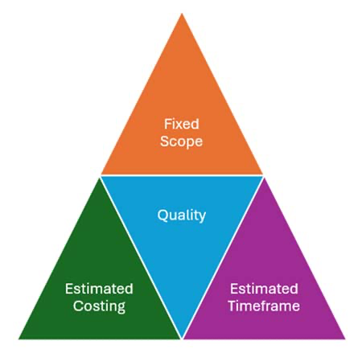

## TMXY174 - Unit 1 Block Project Management

**What is a Project** - > is a temporary endeavour undertaken to create a unique project service or result. It can involve anything from glamorous events of fashion week to humanitarian aid efforts overseas. More specifically a project is a services of structured tasks, activities, and deliverables that are carefully executed to achieve a desired outcome

Points
* Projects are unique
* Projects are temporary in nature and have a define beginning and end date
* Projects initiate change in the organization
* Projects bring about the business value creation

# 1.1.1 Characteristics of your project

**Project ideation** is a phase in which potential project are considered and evaluated to determine whether they are suitable to pursue
 |
  -> Project will be unique in nature -> don't be afraid to stretch and challenge yourself to develop something that you can be proud off at the end of the module

  The project must be completed within a specific timeframe
    -> Done for TMA,EMA

The project will be made up of structured activities and tasks
    -> creating a deliverable
        -> output produced through completed tasks or activities contributing towards the overall project outcome

* The project must have clear goals

* The project must meet the stakeholder meets

* The project will have a positive business impact

# 1.1.2 Project work versus business as usual

**Project work** a planned piece of work that is undertaken within a clear goal. Defined timeframe and specific outcome

**Business as Usual** Regular ongoing operational works that keeps an organisation functioning and it's services running reliability 

**Scope** is a defined boundaries and requirements of a project, determining what the project is intended to deliver. Defining scope prevents the gradual addition of unplanned features

**Cross functional** is a team structure involving people from different functional areas or areas of expertise working together on a project activity

## 1.2 Project Management

THREE IMPORTANT IDEAS
* Tools and techniques
* People
* Describing, organising and monitoring responsibilities

# 1.2.1. Iron Triangle

**An Iron Triangle** a project management concept that shows the interdependent relationship between scope, cost resources as time

**Waterfall** A traditional, step-by-step project methodology in which project activities progress through separate stages in strict order, with requirements typically agreed at the beginning and remaining largely fixed, and approvals required before moving to the next stage.

This figure is a diagram of the project management ‘iron triangle’, consisting of a large triangle divided into four smaller triangles. It features an upright orange triangle at the top labelled ‘Fixed Scope’, which sits across the top points of two further upright triangles below it. On the left is a dark-green triangle labelled ‘Estimated Costing’, while on the right is a purple triangle labelled ‘Estimated Timeframe’. An inverted light-blue triangle labelled ‘Quality’ is centrally placed between the intersecting points of the other three triangles, forming the core of the overall structure.

----

Agile is a  project methodology that uses iterative, incremental development cycles. It emphasises flexibility, responsiveness to change, regular feedback and ongoing collaboration with users. Common Agile approaches include Scrum, Kanban and Extreme Programming.

<img src="./agile.png"

This figure is a diagram of the inverted project management ‘iron triangle’, consisting of a large inverted triangle divided into four smaller triangles. It features two inverted triangles at the top: a dark-green triangle on the left labelled ‘Fixed Costing’ and a purple triangle on the right labelled ‘Fixed Timeframe’. The bottom points of these two triangles meet the top corners of a further inverted triangle, which is orange and labelled ‘Estimated Scope’. An upright light-blue triangle labelled ‘Quality’ is centrally placed between the intersecting points of the other three triangles, forming the core of the overall structure.

