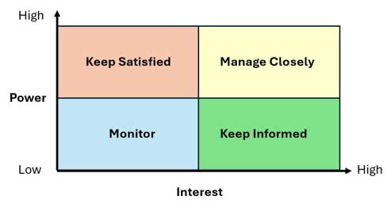

## TMXY174 Unit 3 Block 1 - Effective communication and Collaboration in Project Management

What is an **Artefact**

An **Artefact** are documents or tools that serve as the definitive record of the project reality. You can broadly divide artefacts into two group documents

- **Initiation Artefact** are document projects like project charters or terms of reference are critical in early stage to align stakeholders on a project jod
- **Live Artefacts** Tools such as product backlog on Gantt Chart explored in unit 5 allows anyone involved to instantly understand the effort 

**Single Source of Truth or SSOT** is a central location containing documents, data and information that project participants should use, helping to ensure that works from consistent information

-> Within our KingFisher Organisation, we conduct Daily stands up   
                                            -> More predominantly they are more agile orientated in terms of publishing code to repositories alongside conducting sprints + pair-programming ; Shadowing and more

I wouldn't dare changing the flow of how as a squad conducts cause if everything is moving in an agile flow - > then it should be agile -> unless it's sprints since that's more waterfall predominant.

**Feedback Loops** are a process where feedback is provided and used to identify positive performance, as well as areas remaining in further development or improvement

## 3.2 Stakeholder management and communication planning

**Stakeholder Analysis** is the process of identifying and analysing stakeholders to determine how they should be involved in a project and what information or updates they receive

## 3.2.1 Power Grid

A stakeholder analysis tool that categories stakeholders according go that level of power and interest. Helping to determine how they should be engaged with and communicated with

**Powers** refers to the ability to influence the project and it's outcome

**Interest** refers to the ability to the lead of concern of involvement in the project ultimate success

**Y axis** = low to high in terms of interest
**X axis** = low to high in terms of power

# 3.2.2 Beyond the Grid

What is a **Stakeholder salience model** : A model for prioritising stakeholders that considers factors including power, legitimacy, urgency

The difference between both salience and power grid is how the stakeholder is present in terms of overseeing the project. Adding urgency and legitimacy when implementing stuff -> you're costing time and money which is integral part when producing a project since it comprises of people's time and the tools that they're implementing. It's very sacred if you would want to reach your target.

If i was a stakeholder -> convey and get regular daily meetings with members of staff's who are currently assigned on the project and have them document through confluence or any wiki site of their choice plus a kankan board since the methodology were using is agile - we ensure to have a kankan board for faster production and have updates to customers frequently

# 3 Mastering digital asynchronous collaboration Tools

Many orgs have pre configured tools and workflows depending on your project that you're working for.

In order to flourish there are **3 Distinct key factors in order for more flow and organisation
- **Develop a single source of truth / SS0T**
- **Learn to write effectively of asynchronous communication**
- **Embrace visualisation**

Communication that does not require participants to interact at the same time, such as email or microsoft teams message

## 3.3.1 Develop a single source of truth (SSOT)

As a project manager, it is important to ensure that all the people involved in your project are working and referring to the same documents, data and information. This allows them to work effectively and prevents misunderstandings that take time to resolve.

A modern problem within organisations is the introduction of products such as Microsoft Teams. These may allow easier set-up of localised shared spaces, but without clear instruction or governance, they quickly become difficult-to-navigate repositories.

The transference from email being the main communication and document-sharing method to a more centralised space is ongoing, and will take many years to become an expected behaviour in both tech-savvy and not-so-technically-enabled colleagues.

Microsoft teams is a good software but with no governance and messy layouts can create issues - that's why there's things such as intranet which is the equivalent of a home page for Teams

## 3.2 Learn to write effectively for asynchronous communication

When writing in **Bold** that can draw attention to critical communication

 Considerations for inclusive written context

1) - **Screen Reader**
    - Using heading structure tags such as H1,H2,H3
    -  Alt text - always provide alternative text for images / charts / diagrams so that visually impaired users can understand what's visible on screen

2) - **Clarity on cognitive load**
        - Simplify language - use clear simple language and avoid jargon
        - Helps neurodivergent people
        - Consistent Formatting - Maintain consistent fonts and spacing to reduce cog load
        - Highlighting - use bold text to concepts, but do not rely solely on formatting to convey meaning

3) **Document Navigation**
    - Table of contents  - table of navigation
    - Internal linking - provide links to related sections

**CTA Or commonly known as Call to Action** is a marketing term for a prompt that encourages an audience to take an immediate step

# 3.4.1 Thomas kilman conflict

**Thomas-Kilman conflict** is a model that describes a framework that highlights different approaches for navigation conflict, including collaboration, compromise, avoidance, accommodation, completion.

 - Collaboration - (Win-win) | Gold Standard, require honesty, listening. When to use: Merging different perspectives to gain a answer
 - Compromise (Middle ground) | moderation co op both sides give something up for a better cause | relying on this too often can create a culture where no one is fully satisfied and root causes are never truly addressed
 - Avoidance (Withdrawal) Low-Co-operation between two parties, if used habitually, leaks to informed debt and collapse

 - Competition (directing) How it works: using standing, authority or policy to enforce a decision. How it works: using standing, authority or policy to enforce a decision.

 - Escalation - Escalation is not a negotiation style but a procedural necessity when the project team cannot resolve the issue internally. -  The goal: to protect the project and the team from undue risk by transferring the decision to the appropriate governing body (e.g. Project Board or HR).

# 3.4.2 Feedback Loops

**Retrospective** an agile practice that is used to reflect on what went well, what could be improved and what actions should follow

**Situation-Based-Impact-Workflow** that is used to provide actionable feedback by focusing o the situation behaviour assessed by the impact

**Template for a Situation Based Impact Workflow**

**Situation (context)**

During the daily stand-up this morning …

**Behaviour (observable action)**

… you interrupted several of your colleagues when they were providing updates on their tasks, and you appeared distracted by your phone, as you checked it three to four times in the meeting.

**Impact (consequence)**

I was frustrated with your behaviour because the interruption broke the team’s focus and meant we had to overrun to compensate, making many late to their next meetings or engagements.

# 3.4.3 Culture of trust and team improvement

**Psychological Safety** : A team environment in which people feel able to contribute, communicate and raise concerns without fear of negative consequences.

  - Q1) I feel more confident about Point 2,3 because when it comes to SSOT, i'm able to follow a straight line since documentation is available and 3 because the team members alongside the environment that I'm placed in makes me feel more accountable as a whole

 - Q2) 1,4 -> Big factor because of imposter syndrome, you're still figuring out the structure of the domain that i'm currently working on

 - Q3) Identity I would want to use principle number 1 because when needed help, you're able to designate you're help with the job title role

 - Q4) Taking accountability for not doing you're tasks that has been assigned and not shifting the blame on someone else is not a good sign