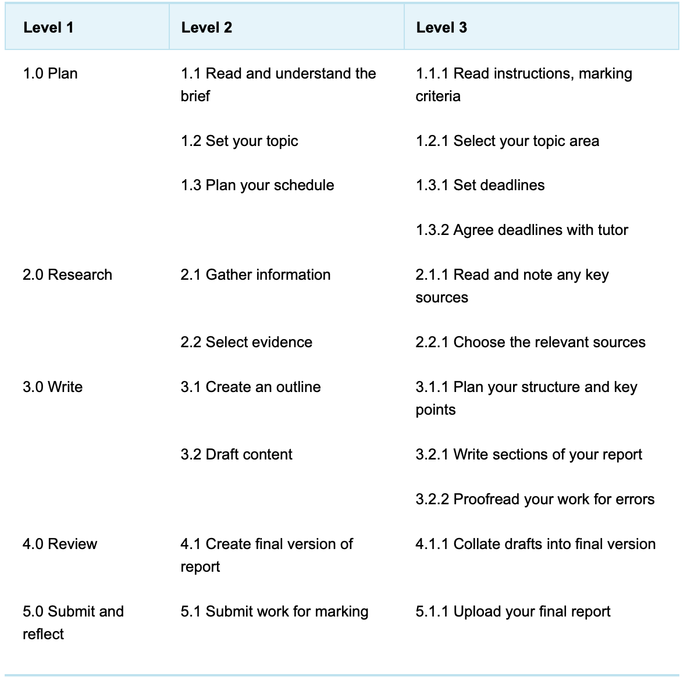
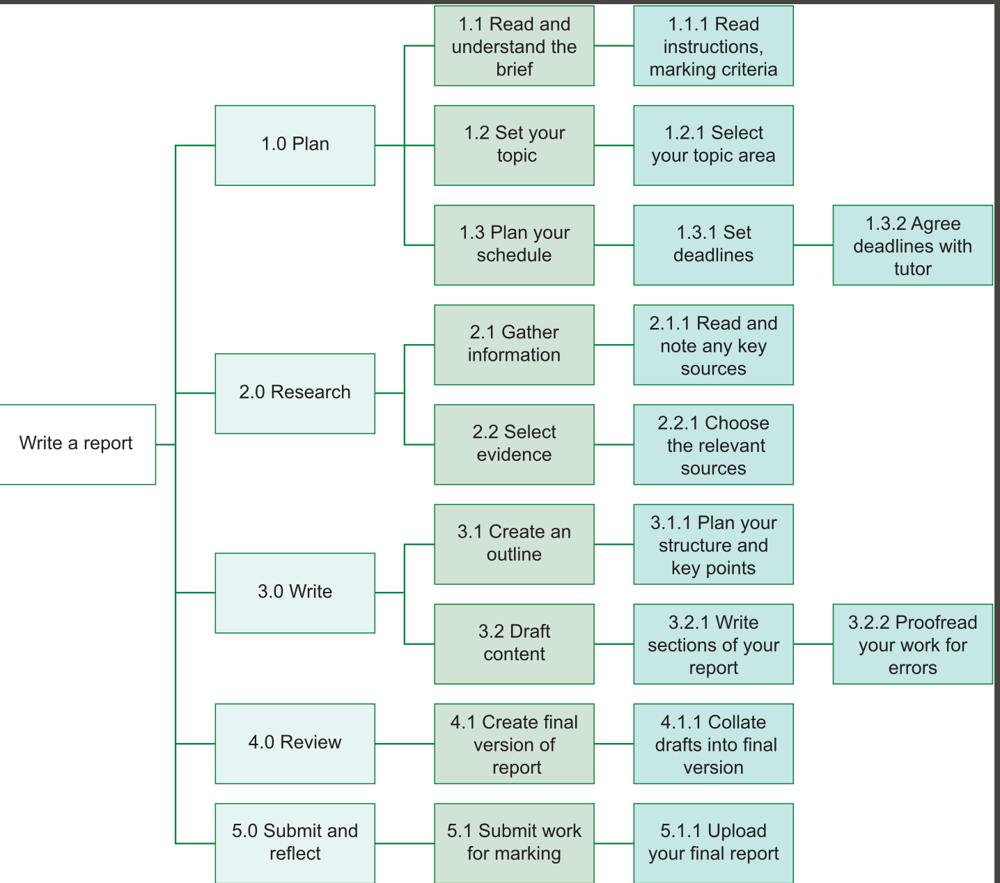
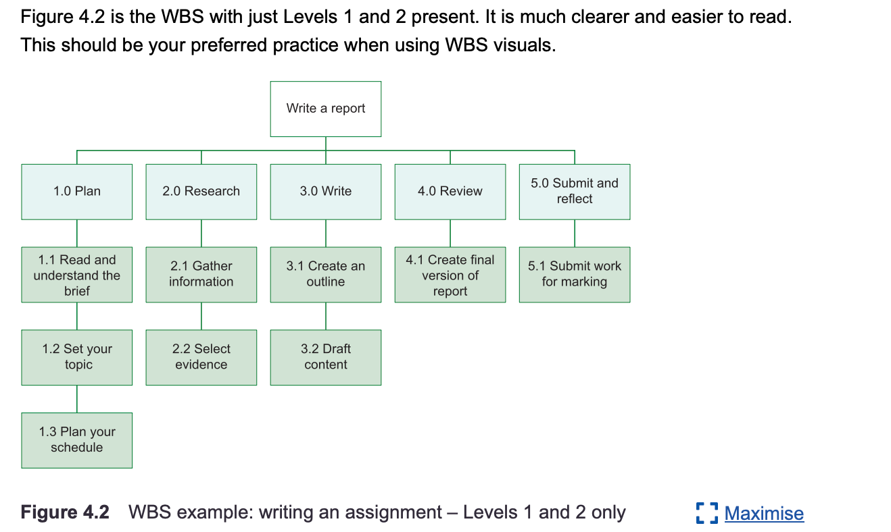

## Unit 4 Block 1 Work Based Structure (WBS)

Work Based Structure is a hierarchal breakdown of all the work required to complete the project, is dividing it into manageable scopes it helps team organise tasks, assign responsibilities and track final progress towards final deliverables.

Dependency: A relationship between activities where one activity cannot start until the other completes, they determine the sequences of the following other tasks

Resource allocation is the process of assigning people, time and other resources required to undertake project activities

The level represents the amount of detail and though process it goes into each tasks / level

Level 1 = The highest level of work break structure, representing the project main phases or goals (The main phases or goals)

Level 2 = The second level of work break structure, representing the major deliverables or tasks within each main project phase. (major deliverables or tasks)

Level 3 = The most detailed level of a work breakdown structure, representing the specific activities that make up the deliverables or tasks. (specific activities that makes up the deliverables)

## Examples of WBS data for writing Assignment

 

